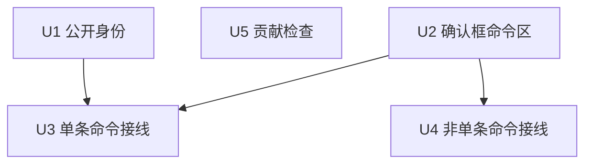

# feat: 补齐开源门槛

> **未实现/待办。** 下面的实现单元都未勾选。不要把本文当成已完成计划，也不要在未被要求时开工。

## Overview

让仓库可以诚实地公开：补 MIT 协议和 Windows-only 说明，并在已有危险操作确认框里展示真实命令。不改 git 写路径，不加功能，不配 Linux/macOS 包。

---

## Problem Frame

访客现在无法判断协议和平台承诺。危险写操作里，重置、丢弃、删分支、强制推送等要么没有可复制命令，要么后端根本不是一条 git 命令。 origin 要求展示与执行一致，不能为了好看编一条 `git clean` 或 `git rebase -i`。（see origin: `docs/brainstorms/2026-10-27-oss-readiness-requirements.md`）

---

## Requirements Trace

- R1. 根目录 MIT `LICENSE`；README 的“开源”表述与协议一致。界面没有关于页，不新做。
- R2. 保持 `package.json` 的 `"private": true`。
- R3. README 顶部英文导语，正文保持中文。
- R4. 只声明已验证的 Windows NSIS；不新增其他打包目标。
- R5. README 预留 3 张真实截图位。没有真实图时标明待补。
- R6. 规定的危险操作在执行前确认，并展示可核对文本。已有确认框只补文本。
- R7. 可复制文本与随后执行的参数一致；能在终端复现的才写成 git 命令。
- R8. 取消、Esc、点遮罩不写仓库。
- R9. 提交、amend、普通推送、fetch、pull、检出、挑拣、还原提交、开始合并或变基不新增确认。
- R10. README 写明每页 200 条、最多 2 万条。
- R11. 不改 `LOG_PAGE_SIZE`、`LOG_FETCH_CAP` 和整页渲染。
- R12. 贡献说明写清 Windows 启动和现有检查，接受中英文问题。
- R13. 增加 Windows 自动化检查文件。仓库尚未公开时，说明它要等远程仓库才会跑。

**Origin actors:** A1 访客，A2 现有 Windows 用户，A3 贡献者
**Origin flows:** F1 判断能不能用，F2 危险操作前核对命令
**Origin acceptance examples:** AE1 重置确认与取消（R6, R7, R8），AE2 强制推送只用 `--force-with-lease`（R6, R7），AE3 README 不夸大平台和性能（R4, R5, R10）

---

## Scope Boundaries

- 不补文件历史、blame、行级暂存、交互式 rebase、图片 diff、语法高亮、主题、worktree、子模块、LFS、提交签名。
- 不做成 GitHub/GitLab 登录或 PR 客户端，也不做成 IntelliJ 运行时客户端，不加插件系统。
- 不新增 Linux/macOS 打包目标，不改 `src-tauri/tauri.conf.json` 的 `bundle.targets`。
- 不改日志分页和渲染，不发布 npm 包，不在未确认时推远程或打 Release。
- 不给 Shelf 删除、本地标签删除、变更列表删除、合并切文件、从列表移除仓库补 git 命令。这些确认保持原样。
- 不把开始合并的现有确认删掉，也不给它补命令。R9 只禁止新增确认。
- 自动更新、代码签名、winget 不做。

### Deferred to Follow-Up Work

- 真实界面截图：实现只留待补标记。用户提供 3 张 Windows 实机图后再替换，不能用生成图。
- 把仓库设为公开并打 Release：另一次确认后的外部操作。

---

## Context & Research

### Relevant Code and Patterns

- 确认队列在 `src/components/common/dialogQueue.ts`，展示在 `src/components/common/ConfirmDialog.tsx`。`files` 已经用等宽字体列路径，命令区应沿这条扩展，而不是新开一套弹窗。
- 复制路径已经用 `navigator.clipboard.writeText`，见 `src/components/Header.tsx`。
- 重置确认已经在 `src/components/GitLogView/CommitGraph.tsx`，`App.tsx` 的 `onReset` 不再确认。强制删除分支的第二次确认在 `App.tsx` 的 `handleDeleteBranch`。
- 丢弃已跟踪文件走 `git restore --source=HEAD --worktree --staged`。未跟踪丢弃走回收站，不是 `git clean`。删除未跟踪文件是直接删磁盘文件。见 `src-tauri/src/git_ops.rs` 的 `discard_paths` 与 `delete_unversioned`。
- 块回滚把补丁从标准输入交给 `git apply -R --unidiff-zero`，并可能再对索引做一次反向应用。见 `apply_chunk`。
- 压缩提交不是 `git rebase -i`。无后续提交时是软重置再提交；有后续提交时还会建临时分支并变基。见 `squash_commits`。
- 强制推送只在 `push_to` 的 `force` 为真时追加 `--force-with-lease`。删除远程标签是 `git push --progress <remote> :refs/tags/<name>`。删除远程分支是 `git push <remote> --delete <branch>`。
- 日志常量是 `LOG_PAGE_SIZE = 200`、`LOG_FETCH_CAP = 20_000`。
- 没有 `.github/`，没有 `LICENSE`，`package.json` 已是 `"private": true`。界面文案里没有“开源”或关于页。
- 没有 `docs/solutions/`。前端没有测试运行器，不能为这次引入。

### Institutional Learnings

- 无。`docs/solutions/` 不存在。

### External References

- 未做外部调研。确认框、git CLI 和 Windows 打包都有现成本地模式。

---

## Key Technical Decisions

- 命令文本放在现有确认框：新增可选命令列表，不新做状态栏或命令面板。取消语义继续走现有 Esc 和遮罩。
- 可复制格式用 `git -C "<仓库路径>"` 加后续参数。Windows 是唯一已验证平台；参数含空格时加双引号。这满足 origin 里“`-C` 还是先 cd”的延期问题。
- 后端不是 git 命令时，不编造 git 命令。未跟踪丢弃写“移入回收站”；删除未跟踪文件写“从磁盘删除”。复制这两句和路径，不写 `git clean` 或 `rm`。
- 块回滚的弹窗只显示 argv，并说明补丁走标准输入。复制内容带上该块补丁，避免弹窗被长补丁撑开。
- 压缩提交的命令写在现有 `SquashDialog` 里，不再套一层确认。按这次预览会走的路径列出真实步骤，包含已有临时分支名；不改成 `git rebase -i`。
- 删除远程标签的命令出现在选中远程之后的 `RemotePickerDialog`，随所选远程变化。前面的意图确认不写还不存在的远程名，避免两次确认。
- 强制推送在勾选后、真正调用推送前增加一次确认。未勾选的普通推送不加。
- 不改 `git_ops.rs` 的写行为。展示对不上时，改展示，不改执行。
- 版权行默认 `Copyright (c) 2026 SnailGit contributors`。仓库没有作者字段，不用本机用户名冒充法律主体。
- 截图未齐不阻塞协议、命令和贡献说明。README 必须明示待补。

---

## Open Questions

### Resolved During Planning

- 可复制命令用 `git -C` 还是先进入目录：用 `git -C`，仓库路径加引号。
- 哪些确认已经存在：重置、丢弃文件、丢弃全部、块回滚、删未跟踪文件、删分支、强制删分支、删远程、删远程标签的意图确认、中止操作、贮藏丢弃都已有确认。重置不在 `App.tsx` 再确认。
- 自动化还是只写文档：两者都做。工作流文件写进仓库；README 说明公开后才会在远程跑。

### Deferred to Implementation

- 压缩提交在“有后续提交”和“有本地改动”两种预览下的完整步骤列表：实现时对照 `squash_commits` 当前分支写，不在计划里抄一份会过期的脚本。
- 重命名文件的丢弃步骤：实现时按 `discard_paths` 对 `old_path` 的现有分支逐条列出，不改该分支。
- Windows 检查工作流的安装步骤：以实现时仓库里的包管理器和工具链为准，不在计划里写死动作版本。

---

## High-Level Technical Design

> *This illustrates the intended approach and is directional guidance for review, not implementation specification. The implementing agent should treat it as context, not code to reproduce.*

用户点危险操作后，仍进入现在那个确认框。框内多一块等宽文本和复制按钮。确认后调用的服务函数不变。

| 操作 | 展示 | 不做什么 |
| :--- | :--- | :--- |
| 单条 git 参数 | `git -C` 加上与后端相同的参数 | 不改后端参数 |
| 回收站或删磁盘文件 | 中文动作加路径 | 不写成 git 命令 |
| 块回滚 | 弹窗显示 argv；复制内容含补丁 | 不把整份补丁铺在弹窗里 |
| 压缩提交 | 按预览路径列出真实步骤 | 不写成交互式变基 |
| 普通推送、检出、提交 | 无新确认 | 不顺便加命令区 |

---

## Implementation Units

- [ ] U1. **公开身份与能力边界**

**Goal:** 访客能从仓库根和 README 判断 MIT、仅 Windows、日志有上限。

**Requirements:** R1, R2, R3, R4, R5, R10, R11；F1；AE3

**Dependencies:** None

**Files:**
- Create: `LICENSE`
- Modify: `README.md`
- Modify: `package.json` 只在发现 `"private"` 被改掉时恢复；当前应保持不动

**Approach:**
- `LICENSE` 使用标准 MIT 正文，版权行用规划决定的默认主体。
- README 顶部用短英文说明：轻量 IDEA 风格 Git 客户端、MIT、仅 Windows 已验证、不是 GitHub PR 客户端。中文正文保留，并把无协议的“开源”改成与 MIT 一致的说法。
- 写明安装包只有 Windows NSIS，Linux/macOS 未支持、欢迎贡献。不改打包配置。
- 写明日志每页 200 条，继续加载到 2 万条后停止。不承诺大仓库丝滑。
- 三个截图位分别对应日志、提交与双栏 diff、Shelf 或三方合并。文件不存在时，README 写“截图待补”，不提交生成图。

**Patterns to follow:**
- 现有 README 的中文结构和 `src-tauri/tauri.conf.json` 的 NSIS 事实。

**Test scenarios:**
- Happy path: 打开 README，第一屏能看到 MIT、Windows-only 和 200/2 万条上限。
- Edge case: 截图文件不存在时，README 明确写待补，而不是指向空图片却声称已有截图。
- Error path: 不适用。本单元不执行 git。
- Integration: `package.json` 仍为 `"private": true`，`bundle.targets` 仍只有 `nsis`。

**Verification:**
- 根目录有 MIT `LICENSE`。
- README 不再把未实现的平台或性能说成已支持。
- 没有新增关于页。

---

- [ ] U2. **确认框可展示并复制命令**

**Goal:** 现有确认框能显示一组等宽文本，并一次复制全部。

**Requirements:** R6, R7, R8；F2

**Dependencies:** None

**Files:**
- Modify: `src/components/common/dialogQueue.ts`
- Modify: `src/components/common/ConfirmDialog.tsx`
- Modify: `src/components/common/ConfirmHost.tsx`
- Modify: `src/i18n/messages.ts`
- Create: `src/components/common/formatGitCommand.ts`

**Approach:**
- 给确认选项增加可选的命令文本列表。空列表或不传时，确认框外观与现在一致。
- 命令区用 `font-mono`，提供复制按钮。复制失败时沿用现有 toast 或按钮旁的失败提示，不因此关闭弹窗，也不执行操作。
- 格式化函数只负责引号和 `git -C`。它不决定某次操作该跑什么。
- 中英文同时加复制、命令区标题。Rust 错误文案不造 i18n key。

**Patterns to follow:**
- `ConfirmDialog` 的 `files` 列表和 Esc 捕获。
- `Header.tsx` 的剪贴板调用。

**Test scenarios:**
- Happy path: 传入两条命令时，弹窗按顺序显示，复制结果是这两条，中间换行。
- Edge case: 不传命令时，没有命令区和复制按钮。仓库路径含空格时，复制文本里的路径被引号包住。
- Error path: 剪贴板写入失败时，弹窗仍开着，操作未执行。
- Integration: Esc、取消和点遮罩仍只关闭弹窗。

**Verification:**
- 不传命令的现有确认框没有新增空白区域。
- 没有新增前端测试框架。

---

- [ ] U3. **单条 git 命令的危险操作**

**Goal:** 参数与后端一致的危险操作，在现有确认里展示可复制命令。

**Requirements:** R6, R7, R8, R9；F2；AE1；AE2

**Dependencies:** U2

**Files:**
- Modify: `src/components/GitLogView/CommitGraph.tsx`
- Modify: `src/App.tsx`
- Modify: `src/components/RemotesModal.tsx`
- Modify: `src/components/GitLogView/RemotePickerDialog.tsx`
- Modify: `src/components/PushDialog.tsx`
- Modify: `src/components/ShelfStashView/index.tsx`
- Modify: `src/components/ProjectSidebar/index.tsx`
- Modify: `src/i18n/messages.ts`
- Test: 无新测试文件。本单元不改 `src-tauri/src/git_ops.rs`

**Approach:**
- 重置：只改 `CommitGraph` 已有确认，展示 mixed reset。`App.tsx` 的 `onReset` 保持直接调用，避免两次确认。
- 删本地分支：第一次确认展示 `-d`；未合并而被拒绝后的强制删除确认展示 `-D`。远程分支名按后端现有规则在第一个斜杠处拆成远程名和分支名，再展示 `push <remote> --delete <branch>`。不要把整串 `origin/feature` 当成分支名。
- `handleDeleteBranch` 在 `force` 为真时会跳过第一次确认。这条路径只能留给已经展示过 `-D` 的第二次确认。若发现其他调用直接传入强制删除，必须先走这次确认，不能静默执行。
- 移除远程：在 `RemotesModal` 已有确认中展示 `remote remove`。
- 删除远程标签：意图确认不写命令。`RemotePickerDialog` 在删除模式下，用当前选中的远程显示 `push --progress <remote> :refs/tags/<name>`。推送标签模式不加命令区。
- 中止操作：按当前 `operation` 展示对应的 `merge|rebase|cherry-pick|revert --abort`。没有进行中的操作时不出现按钮，现有行为不变。
- 丢弃贮藏：`ShelfStashView` 和 `ProjectSidebar` 两处已有确认都展示 `stash drop stash@{index}`，索引与传给后端的一致。
- 强制推送：仅当用户勾选强制推送并按下推送时，先确认。命令含 `--force-with-lease`，含实际上会带的 `--set-upstream` 和 refspec，不含裸 `--force`。取消则不调用推送。
- 不给本地标签删除、Shelf 删除、移除仓库、开始合并补命令。

**Patterns to follow:**
- `handleDeleteBranch` 的两段确认。
- `push_to` 只在 `force` 为真时追加 `--force-with-lease`。

**Test scenarios:**
- Covers AE1. Happy path: 重置确认显示 mixed reset 和目标哈希；取消后不调用重置；确认后调用的仍是现有重置函数。
- Covers AE2. Happy path: 强制推送确认文本含 `--force-with-lease`，不含裸 `--force`；取消后不推送。
- Edge case: 普通推送不弹这层确认。强制删除分支的第二层确认显示 `-D`，不是 `-d`。切换远程标签的目标远程时，命令里的远程名跟着变。
- Error path: 中止时若状态已不是合并、变基、挑拣或还原，不展示一条猜出来的 abort 命令。
- Integration: 贮藏丢弃的两个入口展示同一条索引命令，且只确认一次。

**Verification:**
- 上述入口都能复制出与后端参数一致的文本。
- 提交、检出、普通推送、开始合并没有新确认。
- `git_ops.rs` 无行为改动。

---

- [ ] U4. **不是单条命令的危险操作**

**Goal:** 丢弃、删文件、块回滚和压缩提交也能在执行前核对，且不伪造 git 命令。

**Requirements:** R6, R7, R8；F2

**Dependencies:** U2

**Files:**
- Modify: `src/App.tsx`
- Modify: `src/components/CommitView/ChangelistTree.tsx`
- Modify: `src/components/GitLogView/SquashDialog.tsx`
- Modify: `src/i18n/messages.ts`
- Test: 无新测试文件。不改 `src-tauri/src/git_ops.rs`

**Approach:**
- 已跟踪文件丢弃：在现有单文件和全部回滚确认里，按文件列出 `restore --source=HEAD --worktree --staged`。
- 重命名丢弃：按后端现有顺序列出恢复旧路径，并说明新路径进入回收站。对不上时写明回收站，不改后端。
- 未跟踪丢弃：写移入回收站和路径，不写 git 命令。
- 删除未跟踪文件：沿用“永久删除”语义，写从磁盘删除和路径，不写 `git clean`。确认仍在 `ChangelistTree`，`App.tsx` 不再套一层。
- 块回滚：弹窗显示反向应用的 argv，并说明补丁走标准输入。复制内容包含该块补丁。取消不调用 `applyChunk`。
- 压缩提交：在 `SquashDialog` 确认按钮前列出这次预览对应的真实步骤。有本地改动时包含自动贮藏；有后续提交时包含现有临时分支和变基步骤。现有确认按钮已经要求预览成功且不在加载中；保持这个条件，不要再加一层门禁，也不要在预览出来之前显示步骤。不新增第二个弹窗，不改压缩算法。

**Patterns to follow:**
- `discard_paths` 的三类分支。
- `SquashDialog` 已有的预览字段，而不是再请求一次后端。

**Test scenarios:**
- Happy path: 回滚一个已跟踪文件时，复制文本是对应的 restore 命令；确认后仍调用现有丢弃函数。
- Edge case: 回滚未跟踪文件时，文本明确是回收站，且不含 `git`。删除未跟踪文件的文本明确是磁盘删除。多文件全部回滚时，每条文件一行，顺序与传入路径一致。
- Error path: 块回滚取消后不应用补丁。压缩预览还在加载时，不能确认，也不能显示一条不完整的假步骤。
- Integration: 压缩提交确认后调用的仍是现有压缩函数，弹窗层数不增加。

**Verification:**
- 四类操作的展示与后端分类一致。
- 没有为了让文本好看而修改丢弃、删除或压缩的实现。

---

- [ ] U5. **贡献说明与 Windows 检查**

**Goal:** 贡献者知道如何在 Windows 上启动和检查，并且仓库里有对应的自动化文件。

**Requirements:** R12, R13；A3

**Dependencies:** U1

**Files:**
- Create: `CONTRIBUTING.md`
- Create: `.github/workflows/windows-check.yml`
- Modify: `README.md`

**Approach:**
- 贡献说明用中文，开头注明问题和拉取请求可用中文或英文。
- 写清 Windows 是唯一已验证平台，以及现有前端检查、Rust 检查和桌面启动方式。指向根目录 `AGENTS.md` 的依赖约束，不复制成长篇实现规范。
- 写明这不是 npm 库，不要发布到 npm。
- 工作流只在 Windows 上跑现有的类型检查、前端 lint 和 Rust 测试。不跑发布，不跑 Linux/macOS。
- README 链接贡献说明，并写明自动化要等仓库公开到 GitHub 后才会执行。本计划不推远程。

**Patterns to follow:**
- `package.json` 与根目录 `AGENTS.md` 里已有的脚本名和平台约束。

**Test scenarios:**
- Happy path: 贡献说明能让人找到 Windows 启动方式和三类现有检查，且没有要求 Linux 通过才算完成。
- Edge case: 工作流文件不包含发布、签名或其他平台。
- Error path: 不适用。本计划不执行该工作流。
- Integration: README 能链到贡献说明，且不把未挂上的远程检查写成已经在跑。

**Verification:**
- 两个新文件存在，README 有链接。
- 没有新增依赖，没有发布配置。

---

## System-Wide Impact

- **Interaction graph:** 危险操作仍从现有按钮进入现有确认队列。`ConfirmHost` 是唯一新增展示面。强制推送多一次确认，普通推送不变。
- **Error propagation:** 剪贴板失败只影响复制，不改变确认结果。后端错误文案保持中文直出。
- **State lifecycle risks:** 取消不得调用写函数。压缩和丢弃的展示必须在调用前生成，不能在失败回滚后再补一条不一样的命令。
- **API surface parity:** 贮藏丢弃有两处入口，删分支的普通和强制是两次不同命令。两处都必须对齐，不能只改主界面。
- **Integration coverage:** 前端没有测试运行器。完成标准是类型检查、lint、现有 Rust 测试仍通过，再加上上述手工场景。不新增前端测试框架。
- **Unchanged invariants:** git 写参数、日志分页、NSIS 单一目标、`"private": true`、Shelf 不进 git、强制推送不降级成裸 `--force`。

---

## Risks & Dependencies

| Risk | Mitigation |
| :--- | :--- |
| 前端命令和后端参数以后漂移 | 本计划不改写路径。展示文本与当前函数对照编写；后续改参数时必须同时改确认文本。 |
| 把回收站或删文件写成 `git clean` | U4 明确禁止。文本写文件系统动作。 |
| 同一操作弹两次确认 | 只扩展已有确认。重置、删未跟踪文件、贮藏丢弃不再在调用点外包一层。 |
| 截图被生成图替代 | U1 只允许待补标记或用户提供的实机图。 |
| 工作流在本机无法验证 | 不把“远程已跑绿”写成完成条件。完成是文件存在且范围正确。 |

---

## Documentation / Operational Notes

- 用户可见文档是 `README.md`、`LICENSE`、`CONTRIBUTING.md`。
- 不推远程，不打 Release，不发布 npm。
- 截图待用户从 Windows 应用实机提供。

---

## Sources & References

- **Origin document:** [docs/brainstorms/2026-10-27-oss-readiness-requirements.md](docs/brainstorms/2026-10-27-oss-readiness-requirements.md)
- Related code: `src/components/common/ConfirmDialog.tsx`，`src-tauri/src/git_ops.rs` 的 `discard_paths`、`delete_unversioned`、`apply_chunk`、`push_to`、`squash_commits`、`delete_branch`、`delete_remote_tag`、`abort_operation`
- Related PRs/issues: 无
- External docs: 无
